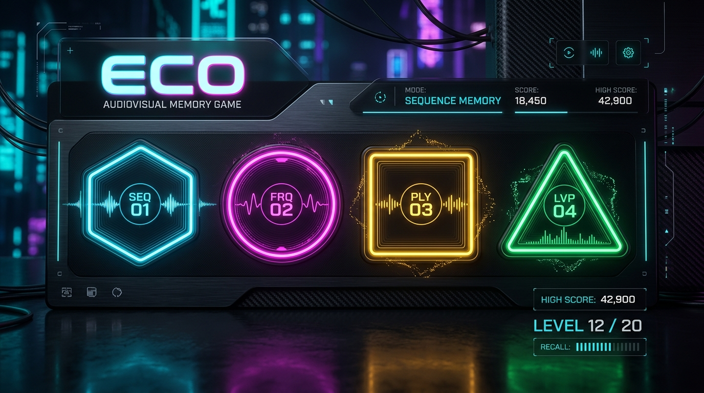

<div align="center">

# ⚡ ECO — Audiovisual Memory & Rhythm

<p align="center">
  <strong>Jogo sensorial de memória, reflexo e ritmo audiovisual com síntese sonora procedural via Web Audio API.</strong>
</p>

[](https://github.com/leonardoconstantino/eco/actions/workflows/deploy.yml)


<br />

### 🎮 [JOGAR AGORA NO GITHUB PAGES](https://leonardoconstantino.github.io/eco/)

<br />

<p align="center">
  
</p>

</div>

---

## 🌟 Sobre o Projeto

**ECO** é uma reimaginação moderna e sensorial do clássico conceito de desafio de memória e ritmo. Construído com tecnologias web de ponta, o jogo combina design minimalista com uma experiência tátil e auditiva imersiva, utilizando a **Web Audio API** para síntese analógica em tempo real de notas, osciladores e harmônicos sem dependência de arquivos de áudio pré-gravados.

A cada acerto, o andamento acelera, os reflexos são colocados à prova e novas mecânicas entram em cena.

---

## 🕹️ Modos de Jogo

| Modo | Descrição |
| :--- | :--- |
| **Clássico** | O teste puro de ritmo e memória. A sequência ganha um novo passo a cada rodada e o intervalo de reprodução diminui progressivamente. |
| **Tabuleiro Vivo** | Os quadrantes rotacionam, trocam de posição ou alteram suas geometrias periodicamente, forçando você a memorizar os tons e cores ao invés de apenas as posições físicas. |
| **Eco Reverso** | Memorize a sequência e reproduza-a de trás para frente. Um desafio cognitivo intenso que exige raciocínio e concentração redobrados. |
| **Zen** | Sessão contemplativa sem cronômetro restritivo e sem *game over*. Ideal para relaxar, afinar o ouvido e harmonizar o fluxo sonoro no seu próprio ritmo. |

---

## ✨ Principais Funcionalidades

- **Síntese de Áudio Procedural**: Motor sonoro nativo (`AudioEngine`) com osciladores (sine, triangle, sawtooth, square), filtros passa-baixas e envelopes de volume suaves.
- **Temas e Paletas Desbloqueáveis**: Conquiste marcos de pontuação para liberar paletas de cores (*Cyberpunk, Synthwave, Monocromático, Pastel, Jade*) e timbres sonoros (*Analógico Clássico, Chiptune 8-bit, FM Metálico, Marimba Acústica*).
- **Persistência Completa de Dados**: Histórico de sessões, melhores pontuações, tempos recordes e conquistas salvos localmente via IndexedDB (`Dexie.js`).
- **Feedback Háptico & Acessibilidade**: Resposta por vibração em dispositivos compatíveis, indicadores visuais de foco e suporte total a navegação por teclado.
- **Deploy Contínuo Automatizado**: Integração e entrega contínua com GitHub Actions para GitHub Pages com base path dinâmico.

---

## ⌨️ Controles e Atalhos

O jogo foi projetado para responder instantaneamente tanto ao toque em telas móveis quanto a cliques do mouse e atalhos rápidos de teclado:

```
          [ Q ] ou [ 1 ]           [ W ] ou [ 2 ]
          (Quadrante 0)             (Quadrante 1)

          [ A ] ou [ 3 ]           [ S ] ou [ 4 ]
          (Quadrante 2)             (Quadrante 3)
```

- **Setas do Teclado**: Também podem ser utilizadas para disparar os respectivos quadrantes.
- **Barra de Espaço / Enter**: Inicia partidas ou avança telas de resultados.
- **Esc / P**: Pausa a partida em andamento.

---

## 🚀 Como Executar Localmente

### Pré-requisitos
- [Node.js](https://nodejs.org/) versão **20.x** ou superior
- Gerenciador de pacotes `npm`, `yarn`, `pnpm` ou `bun`

### Passo a Passo

1. **Clone o repositório:**
   ```bash
   git clone https://github.com/leonardoconstantino/eco.git
   cd eco
   ```

2. **Instale as dependências:**
   ```bash
   npm install
   ```

3. **Inicie o servidor de desenvolvimento:**
   ```bash
   npm run dev
   ```
   Acesse a aplicação no seu navegador em `http://localhost:3000`.

4. **Gere a build de produção:**
   ```bash
   npm run build
   ```

5. **Visualize a build gerada:**
   ```bash
   npm run preview
   ```

---

## 🔄 Deploy Automático (GitHub Actions & GitHub Pages)

O projeto conta com um fluxo de CI/CD automatizado no arquivo [`.github/workflows/deploy.yml`](.github/workflows/deploy.yml).

### Como funciona:
1. Ao realizar um `git push` nas branches `main` ou `master` (ou ao disparar manualmente via `workflow_dispatch`), o workflow é acionado.
2. O runner em Ubuntu com Node.js 20 instala as dependências e executa `npm run build` com a variável `GITHUB_ACTIONS=true`.
3. O `vite.config.ts` ajusta automaticamente o caminho base para `/eco/`.
4. Os arquivos estáticos da pasta `dist/` são empacotados e publicados diretamente no GitHub Pages através das ações oficiais `actions/upload-pages-artifact@v3` e `actions/deploy-pages@v4`.

---

## 🛠️ Tecnologias Utilizadas

- **Framework**: [React 19](https://react.dev/)
- **Linguagem**: [TypeScript](https://www.typescriptlang.org/)
- **Build Tool**: [Vite 6](https://vitejs.dev/)
- **Estilização**: [Tailwind CSS 4](https://tailwindcss.com/)
- **Áudio**: Web Audio API nativa (OscillatorNode, GainNode, BiquadFilterNode)
- **Persistência**: [Dexie.js](https://dexie.org/) (IndexedDB wrapper)
- **Animações e Efeitos**: [Motion](https://motion.dev/) & [Canvas Confetti](https://www.npmjs.com/package/canvas-confetti)
- **Ícones**: [Lucide React](https://lucide.dev/)

---

## 📄 Licença

Este projeto é distribuído sob a licença **MIT**. Consulte o arquivo [LICENSE](LICENSE) para obter mais informações.

<div align="center">
  <p>Desenvolvido com dedicação por <strong>Leonardo Constantino</strong></p>
</div>
